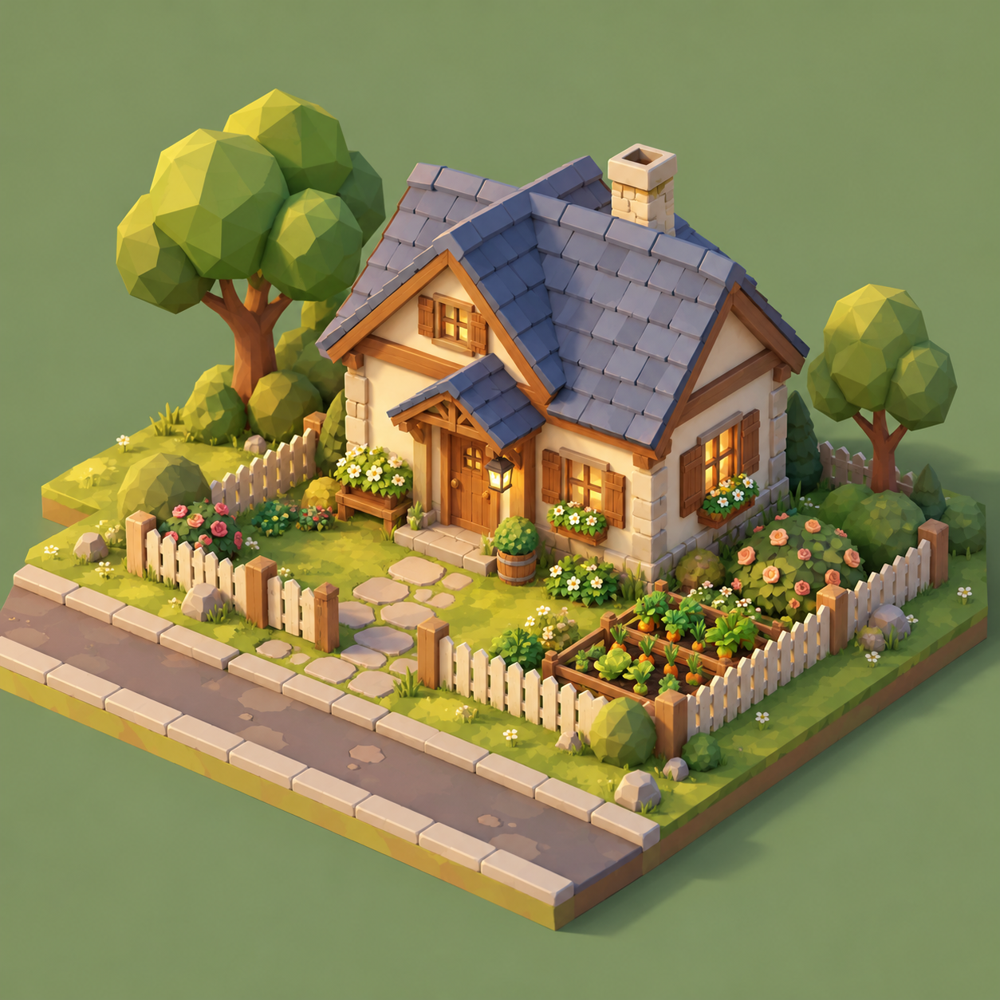
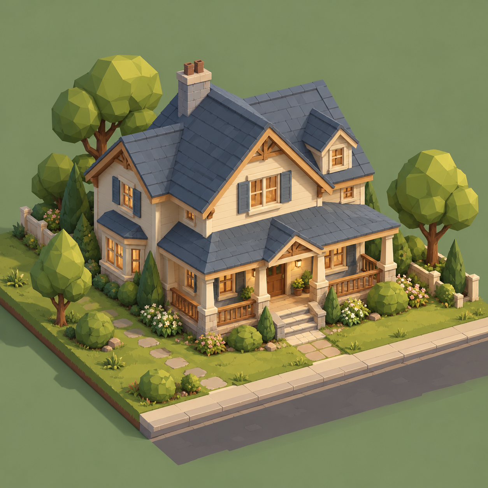
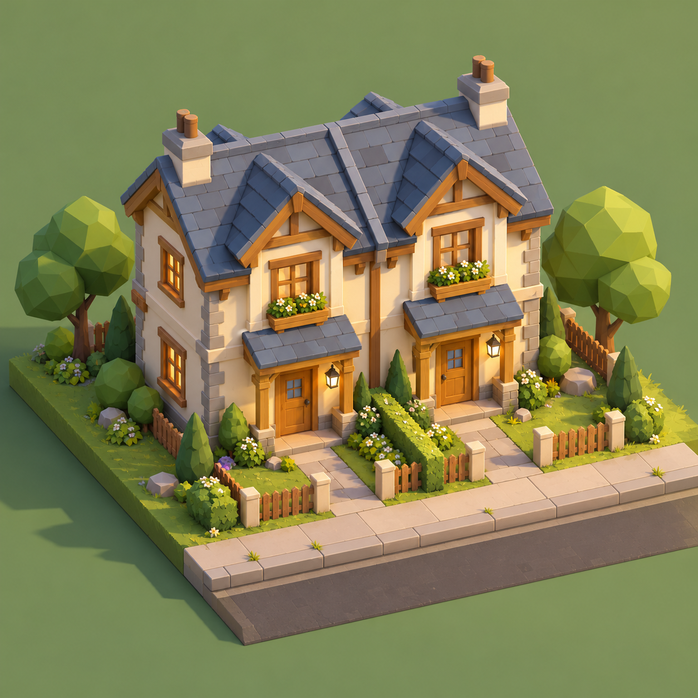
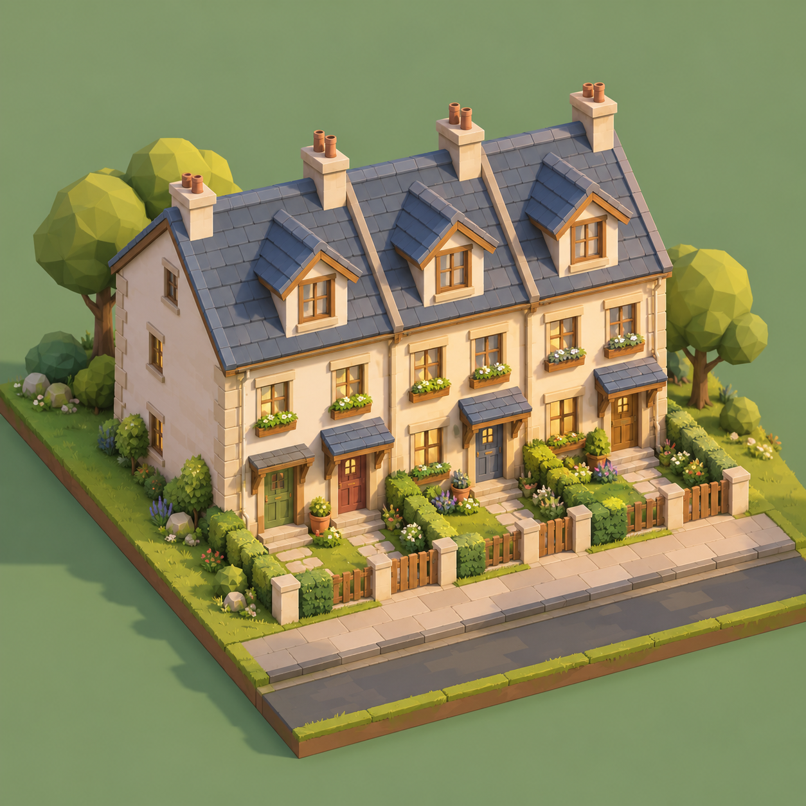
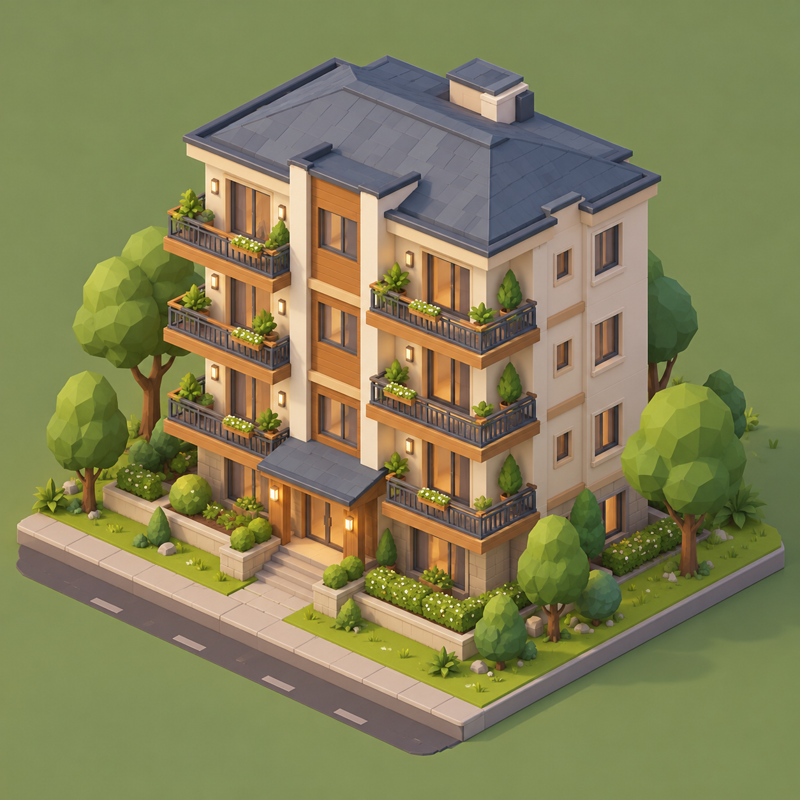
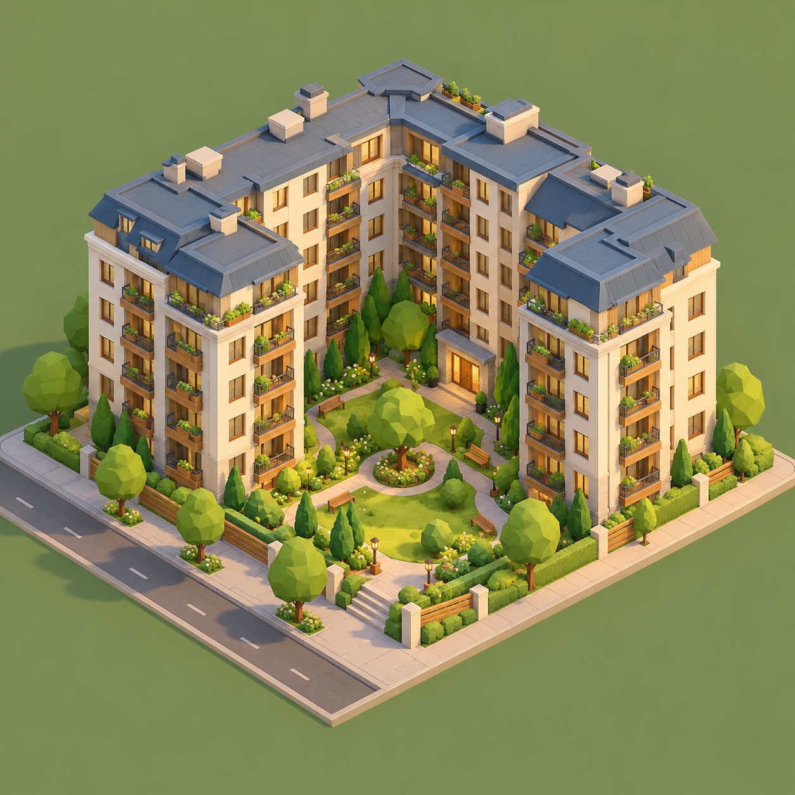
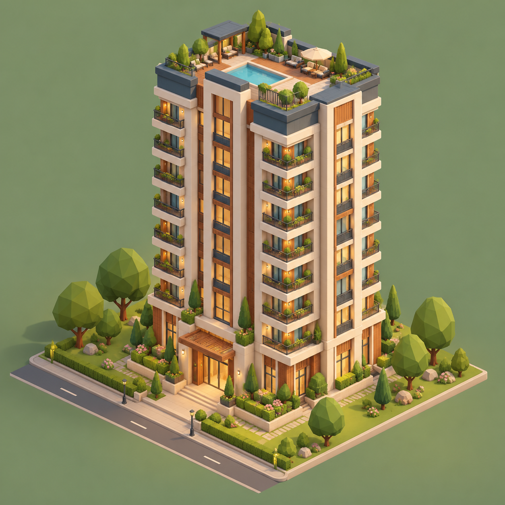
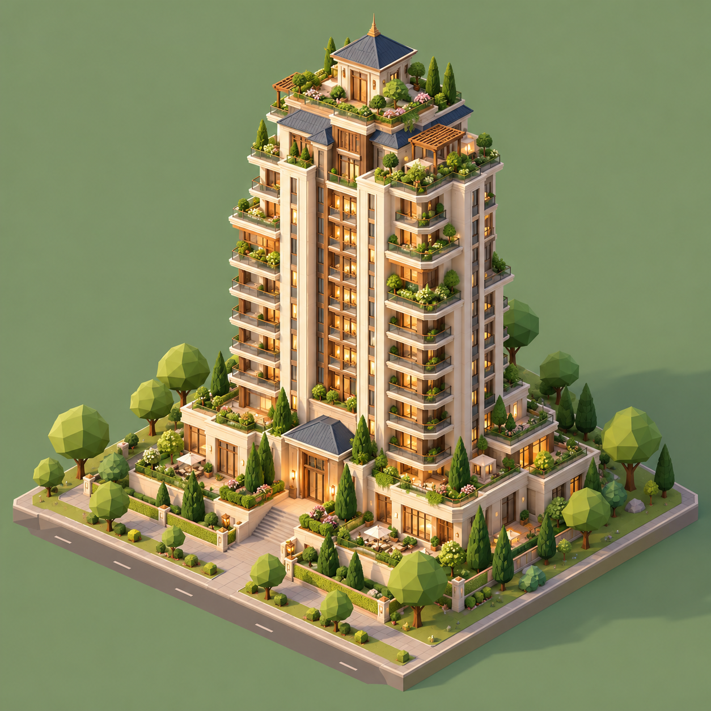

# Eight home tiers

Generated concept art. Each tier is now modeled in-game as low-poly geometry after these images (`web/src/home-tiers.js`); in-game screenshots are in [docs/screenshots/home-tiers](../../screenshots/home-tiers). The images themselves are not bundled into the game. Reference: the player’s Agent World screenshot, October 11, 2026.

A home pools its current residents’ lifetime participation XP. Each completed game response awards 25 XP; failed/cancelled responses do not. One slot unlocks at each home level, starting with the Personal Assistant at level 1. Unlocking a slot never recruits automatically.

| Level | Home | Total XP | Slots | Total completed responses |
|---|---|---:|---:|---:|
| 1 | [Cottage](01-cottage.png) | 0 | 1 | 0 |
| 2 | [Family House](02-family-house.png) | 100 | 2 | 4 |
| 3 | [Duplex](03-duplex.png) | 750 | 3 | 30 |
| 4 | [Townhouse Row](04-townhouse-row.png) | 2,000 | 4 | 80 |
| 5 | [Small Apartment Building](05-small-apartment-building.png) | 4,000 | 5 | 160 |
| 6 | [Apartment Block](06-apartment-block.png) | 7,000 | 6 | 280 |
| 7 | [Residential Tower](07-residential-tower.png) | 11,000 | 7 | 440 |
| 8 | [Landmark Residence](08-landmark-residence.png) | 16,000 | 8 | 640 |

The first two unlocks retain 100 and 750 XP. Later level costs rise by 1,250 / 2,000 / 3,000 / 4,000 / 5,000 XP, accounting for more contributors as the household grows. At maximum, 640 completed responses across residents are required. This is an initial balance, not a measured playtest result or a task quality score. Real elapsed time depends on workload. Existing saved XP is preserved and levels are recalculated from the new thresholds.

## 1. Cottage

## 2. Family House

## 3. Duplex

## 4. Townhouse Row

## 5. Small Apartment Building

## 6. Apartment Block

## 7. Residential Tower

## 8. Landmark Residence

